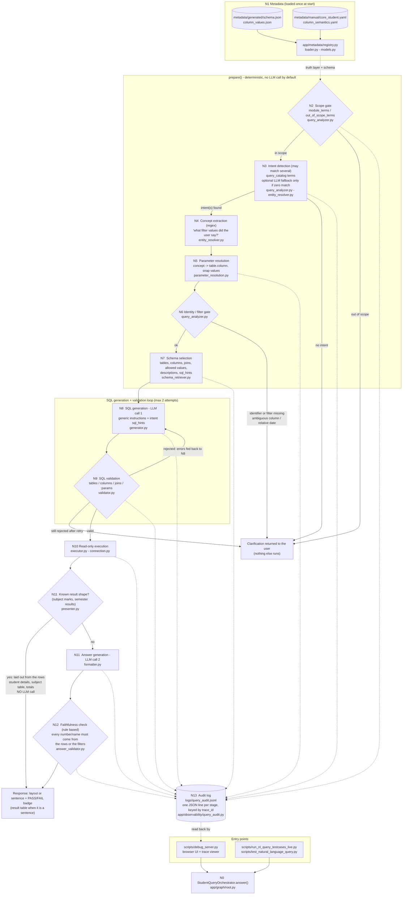
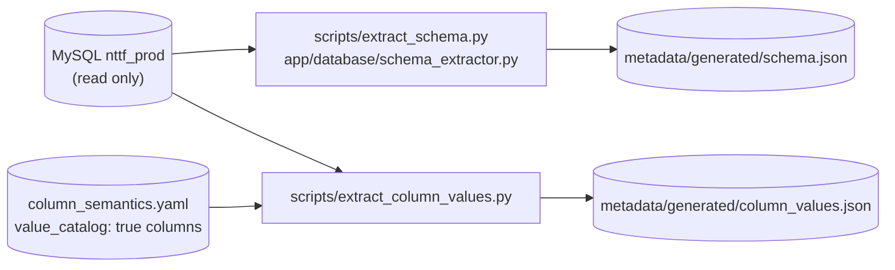

# Architecture

In VS code press ctrl + k then v

How the NTTF ERP natural-language-to-SQL chatbot works, end to end, and — for
every step — which file to open. Companion docs:

- [ADDING_A_NEW_QUERY.md](ADDING_A_NEW_QUERY.md) — step-by-step for developers who
  want to add tables / a new kind of question.
- [SOP.md](SOP.md) — day-to-day operations (run the UI, switch LLM, refresh metadata).
- [QUERY_CAPABILITIES.md](QUERY_CAPABILITIES.md) — every kind of question answered
  today, testable filter/grouping combinations, and verified examples.
- [../README.md](../README.md) — scope rules (Core Programme student data only).

> Line links (`#L95`) point at the function named next to them. If a file has
> been edited since, search for the function name instead.

---

## 1. One request, start to finish

Every entry point (browser UI, scripts, tests) calls the same method,
[`StudentQueryOrchestrator.answer()`](../app/graph/root.py#L170). Only **two**
steps call an LLM (N8 and, for shapes without a fixed layout, N11 - plus an optional intent fallback in N3). Everything
else is deterministic Python, so a wrong table, column, join, filter value or
number can never come from a model's imagination — it is either taken from
verified metadata or rejected.

Offline refresh jobs (run by a developer, not per request):

---

## 2. Node reference — what each step does and where the code is

| Node | What happens | Open this file | Steered by (metadata / config) | Trace stage in the log |
|---|---|---|---|---|
| **N0** Orchestrate | Runs N2→N12 in order, retries SQL generation once with the rejection reasons, degrades every failure into a clarification instead of a crash | [`root.py` `answer()`](../app/graph/root.py#L170), [`prepare()`](../app/graph/root.py#L46), [`generate_and_validate()`](../app/graph/root.py#L78), [`execute_validated()`](../app/graph/root.py#L113), [`synthesize_answer()`](../app/graph/root.py#L144); state object: [`state.py`](../app/graph/state.py) | — | `pipeline_complete` |
| **N1** Metadata | Loads generated schema + hand-written truth layer, validates that every table/column named in the YAML really exists (typos fail at start-up) | [`registry.py`](../app/metadata/registry.py#L10), [`loader.py`](../app/metadata/loader.py#L10), [`models.py`](../app/metadata/models.py) | `metadata/generated/*.json`, `metadata/manual/*.yaml` | — |
| **N2** Scope gate | Rejects out-of-scope words (`legs`, `placement`, `deployment`); requires at least one Core-student word so random questions aren't answered | [`query_analyzer.py` `analyze()`](../app/intelligence/query_analyzer.py#L95) | `semantic.module_terms`, `semantic.out_of_scope_terms` in [core_student.yaml](../metadata/manual/core_student.yaml) | `received_query`, `clarification` |
| **N3** Intent detection | Every `query_catalog` entry whose `terms` appear in the question is matched — **several can match** and are unioned. Only if none match, an LLM picks from the known catalog (never invents one) | [`_intents()`](../app/intelligence/query_analyzer.py#L199); LLM fallback: [`LLMIntentClassifier`](../app/intelligence/entity_resolver.py#L568) | `query_catalog.<intent>.terms` | `query_analysis` |
| **N4** Concept extraction | Regex turns wording into `(concept, value)` pairs ("center Peenya", "semester three", "student code = X", "2026 JUN and 2025 JUN"). Knows nothing about tables. Guards against swallowing prose as a value | [`RegexConceptExtractor`](../app/intelligence/entity_resolver.py#L216), grammar: [`_value_group`](../app/intelligence/entity_resolver.py#L85), stop words: [`_STOPWORDS`](../app/intelligence/entity_resolver.py#L118) | `semantic.parameters` (curated concepts), hint vocabulary from the intent's `filter_tables` columns + `column_semantics` aliases | `query_analysis` (`concept_extraction`) |
| **N5** Parameter resolution | Maps each concept to one `table.column` (curated → `alternates` → dynamic column search, preferring `preferred_filter_tables`), then maps the value onto the column's real vocabulary: DB ENUM, value catalog ("Peenya" → `BTC - PEENYA`, "2024" → all 2024 sessions), number words ("three" → 3) | [`ParameterResolver.resolve()`](../app/intelligence/parameter_resolution.py#L253), [`_snap_to_known_values`](../app/intelligence/parameter_resolution.py#L182), [`_snap_to_enum_value`](../app/intelligence/parameter_resolution.py#L142), [`_finalize_values`](../app/intelligence/parameter_resolution.py#L204) | `semantic.parameters.*.alternates`, `query_catalog.*.filter_tables / preferred_filter_tables`, `column_semantics.*.aliases / value_catalog`, `column_values.json` | `query_analysis` (`parameter_resolution`) |
| **N6** Identity / filter gate | A "per-student" intent needs an identifier (enquiry no., hall ticket, student code). Results may instead accept any one filter (`identity_optional_with_filters`). Also stops on ambiguous columns and relative dates ("previous academic year"), and asks for a semester when a **consolidated** result is requested without one ("…or say 'for all semesters'"). For results questions it also reads the **result scope** (regular / supplementary N / consolidated / grade asked) from the wording — [`result_scope.py`](../app/intelligence/result_scope.py) — and passes it to N8, N9 and N11 | [`_identity_missing()`](../app/intelligence/query_analyzer.py#L177) | `query_catalog.*.requires_identity / identity_optional_with_filters` | `clarification` |
| **N7** Schema selection | Builds the *minimal* schema the LLM may use: union of every matched intent's tables, `output_columns`, verified `relationships`; adds column `allowed_values`, curated `description`s and the intents' `sql_hints`. Never the whole 387-table schema | [`SchemaRetriever.retrieve()`](../app/intelligence/schema_retriever.py#L59), [`_selected_columns()`](../app/intelligence/schema_retriever.py#L117) | `query_catalog.*.tables / output_columns / required_relationships / sql_hints`, `relationships`, `column_semantics.*.description / allowed_values` | `schema_selection` |
| **N8** SQL generation (LLM #1) | One JSON-only prompt: question + interpreted parameters + minimal schema + generic rules + the matched intents' `sql_hints` (+ the previous rejection on a retry). The deterministic parameter *values* always overwrite whatever the model returns | [`build_sql_generation_context()`](../app/sql/generator.py#L15), [`SQLGenerator.generate_sql()`](../app/sql/generator.py#L101), providers: [`SarvamSQLClient`](../app/sql/generator.py#L162) / [`GeminiSQLClient`](../app/sql/generator.py#L225) | generic rules in `generator.py`; per-question rules in `query_catalog.*.sql_hints`; `.env` `LLM_PROVIDER` | `sql_generation_attempt`, `sql_generation`, `sql_generation_error` |
| **N9** SQL validation | Read-only `SELECT` only; every table/column must be in the minimal schema; every `JOIN … ON a=b` must be a verified relationship; every `:placeholder` must be a supplied parameter; a results question that covers every exam attempt may not filter on `final_exam_type`/`suppl_no`, and a consolidated one must return subject rows. Failures go back to N8 (once) | [`SQLValidator.validate()`](../app/sql/validator.py#L31) | the selection from N7 | `sql_validation` |
| **N10** Execution | Runs the validated SQL read-only, binds list values as `IN`, caps rows | [`SafeQueryExecutor.execute()`](../app/database/executor.py#L28), [`connection.py`](../app/database/connection.py) | `.env` DB settings, `QUERY_MAX_ROWS` (default 100) | `db_execution` |
| **N11** Result presentation | **First** a deterministic presenter checks the returned columns: subject-wise marks become a mark sheet — the student's repeated details (name, code, program, stream, academic year, current status, father name …) as **points**, then **one table per exam attempt** (regular, supplementary 1…10; columns: subject, code, midterm, endterm, total, grade/GP if asked, subject Pass/Fail) each followed by its grand total / SGPA / CGPA / overall result as points; a *consolidated* request shows the latest attempt of every subject; per-semester results a semester table; **grouped counts** ("strength center / program / stream / academic year / status wise") a table of the group columns + strength with the question's filters as points above and the total below; big cohorts one flat table — copied from the rows, **no LLM call**, so nothing can be invented. Only for any other shape does the answer LLM (#2) write 1–3 sentences (rows sent as compact arrays, up to 100; told not to invent or calculate numbers) | presenter: [`build_presentation()`](../app/response/presenter.py) (add a layout = add a `_present_*` function to `_PRESENTERS`); LLM path: [`build_answer_generation_context()`](../app/response/formatter.py#L46), [`AnswerGenerator`](../app/response/formatter.py#L67); the switch is in [`synthesize_answer()`](../app/graph/root.py#L144) | which columns the SQL selects (steered by the intent's `sql_hints`); `formatter.py` instruction list | `presentation` or `answer_generation` |
| **N12** Faithfulness check | Rule-based (no LLM), for sentence answers: every number in the answer must be a row value, the row count or a filter value; a non-empty answer must quote something from the rows. Labels the answer, never blocks it. A presenter layout is marked valid by construction | [`AnswerFaithfulnessValidator.validate()`](../app/response/answer_validator.py#L50) | — | `answer_validation` |
| **N13** Audit + UI | One JSON line per stage, all sharing a `trace_id` (secrets like email/mobile redacted in the log). The browser page is only a viewer over this log plus the result table | [`QueryAudit`](../app/observability/query_audit.py#L14), [`debug_server.py`](../scripts/debug_server.py#L181) | `.env` `QUERY_AUDIT_LOG` | — |

---

## 3. The metadata files — which key is read by which node

All business knowledge lives in two hand-edited YAML files plus two generated
JSON files. Adding a new kind of question is almost always a YAML change
(see [ADDING_A_NEW_QUERY.md](ADDING_A_NEW_QUERY.md)).

### [`metadata/manual/core_student.yaml`](../metadata/manual/core_student.yaml)

| Key | Meaning | Consumed by |
|---|---|---|
| `relationships.<name>` | A join the system is allowed to write. `verified: true` only if proven from a Laravel model, a real FK, or (flagged `source: data_verified`) live data | N7 selection, N9 join check |
| `semantic.module_terms` / `out_of_scope_terms` | The scope gate words | N2 |
| `semantic.synonyms` | Other words users say for a domain word (`student: [trainee, learner]`, `count: [strength, headcount]`). The question is rewritten with the canonical word (plurals kept) before every match, and the SQL model is shown the rewritten question as `normalized_question` | N2–N4, N8 |
| `semantic.parameters.<concept>` | Curated filter concepts (identifiers, `status`, `program`): `table`, `column`, `aliases` or hand-written `patterns`, optional `alternates: {table: column}` | N4, N5 |
| `query_catalog.<intent>.terms` | Words that trigger this kind of question | N3 |
| `…​.tables` | Every table the question may touch | N7 |
| `…​.output_columns` | Per table, the columns the LLM may select **and join on** (join keys must be listed) | N7, N9 |
| `…​.required_relationships` | Joins available to this question | N7, N9 |
| `…​.filter_tables` | (optional) Tables whose columns may act as *filters*; leave lookup/output-only tables out so their column names don't become bogus filters | N3→N4/N5 |
| `…​.preferred_filter_tables` | (optional) Where a filter concept should resolve when the same name exists on several tables (results filters → `core_exam_results`) | N5 |
| `…​.requires_identity` / `identity_optional_with_filters` | Needs a specific student's identifier — or, when the second flag is set, any one filter instead | N6 |
| `…​.sql_hints` | Rules/templates injected into the LLM prompt **only** when this intent matched | N7→N8 |

### [`metadata/manual/column_semantics.yaml`](../metadata/manual/column_semantics.yaml)

| Key (per `table.column`) | Meaning | Consumed by |
|---|---|---|
| `description` | Plain-language meaning / warning, sent to the LLM with the column | N7 |
| `aliases` | Other words for the column; also become extraction vocabulary and score higher than raw names | N4, N5 |
| `allowed_values` | Closed vocabulary for a column that is not a real DB ENUM (VARCHAR with fixed values) | N7, N5 |
| `value_catalog: true` | Snapshot this column's real distinct values (`scripts/extract_column_values.py`) so partial wording snaps to stored values | N5 |

### Generated (never hand-edit)

| File | Produced by | Contains |
|---|---|---|
| [`metadata/generated/schema.json`](../metadata/generated/schema.json) | [`scripts/extract_schema.py`](../scripts/extract_schema.py) | every table/column/type, primary & foreign keys, real DB ENUM values |
| [`metadata/generated/column_values.json`](../metadata/generated/column_values.json) | [`scripts/extract_column_values.py`](../scripts/extract_column_values.py) | distinct values of `value_catalog` columns |

---

## 4. Query catalog today

> **Exam attempts** (`core_exam_results`): `final_exam_type` NULL or `'semester'` = the regular exam; `'supplementary'` with `suppl_no` 1…10 = supplementary attempts. "Semester 1 result" means *all* attempts (one table each); "regular" / "supplementary 2" only that one; "consolidated" the latest attempt of each subject. Subject pass/fail comes from the grade (`F` = Fail, `AB` = Absent, `A`–`E` = Pass); an attempt's overall result is Fail if the recorded status is `F`/`Fail` or any subject failed.

| Intent | Answers questions about | Main tables | Needs |
|---|---|---|---|
| `student_listing` | lists/counts/details of students (name, DOB, program, stream, academic year, status, batch …); **strength** (student count) in total or broken down center / program / stream / academic year / status wise, for any `student_admissions.status` | `student_leads`, `student_admissions` | nothing |
| `student_result` | subject-wise marks, SGPA/CGPA, grand total, result/fail status — **by one student (code) or by cohort filters** (center, program, stream, academic year, semester; any one is enough) | `core_exam_results` (+ `student_admissions`, `student_leads` for names) | student code **or** ≥1 filter |
| `student_certificate` | certificates | `student_certificates` | identifier |
| `student_family` | father / mother / guardian details | `student_families`, `family_details` | identifier |
| `student_payment` | payments, "paid / not paid" (anti-join) | `student_payments` | nothing |
| `student_referral` | who gave the referral, referral type (lead source) | `student_referrals`, `lead_master` | identifier |
| `student_referrer_details` | details of the referrer: employee (`employees`, `users`) or student (second `student_admissions`/`student_leads` pair) | `employees`, `users` | identifier |
| `student_attendance` | presence/absence on a date or today, late arrivals (first punch after a 09:30 cutoff) and their weekly average, N-day continuous absence, which center/program/batch/section/group has the lowest/highest attendance — filterable the same way as `student_listing` (center, program, stream, batch, section, group, academic year, status, gender, hostel) | `biometric_info` (+ `student_admissions`, `student_leads`) | nothing |

`student_listing` also answers hostel/gender breakdowns ("how many boys and
girls are hostellers", "day scholars center wise") by grouping on
`gender`/`residency_type` like any other "`<dimension>` wise" strength question.

Several intents can be active in one question ("student detail + father name +
SGPA per semester" = `student_listing` + `student_family` + `student_result`).

---

## 5. Design principles (why it is built this way)

1. **Deterministic first, LLM as a bounded fallback.** Anything that can be
   decided by metadata or a regex is; an LLM only writes the SQL text (N8),
   the sentence (N11) and, if nothing matched, picks an intent (N3) — and every
   LLM output is validated against something known.
2. **Extraction ≠ resolution.** N4 says *what the user meant*; N5 decides
   *which column that is*. N4 never sees a table name.
3. **Verified joins only.** A join exists only as a `relationships` entry. The
   validator rejects any other `ON a = b`.
4. **Minimal schema.** The model sees 2–7 tables, not 387; fewer choices, fewer
   mistakes, cheaper prompts.
5. **Ground the model in real values.** ENUM/curated `allowed_values`, value
   catalogs and column descriptions exist because the model otherwise guesses
   (it once reused one column's ENUM value for another; it once filtered on a
   look-alike column that is 'Member' on 82 % of rows).
6. **Show data as data.** A mark sheet is a table, not a sentence: recognised
   result shapes are rendered by code from the rows (no LLM, nothing to
   hallucinate). For sentences, never trust, always label: the faithfulness check
   labels a wrong-looking answer rather than hiding it, and the UI shows the badge
   and the raw result table.
7. **Retry with the reason.** A rejected statement is regenerated once with the
   validator's errors in the prompt.

---

## 6. Known limitations

1. **Regex extraction is heuristic at the edges.** A column-derived word right
   before ordinary prose can be read as a filter ("employee details", "subject
   wise"). Mitigations: `_STOPWORDS`, `filter_tables`, shape check on value
   lists. A wrong extraction is fixed by root-causing *which* word/column
   poisoned it, not by patching one sentence.
2. **Referrer links are data-verified, not Laravel-verified.**
   `student_referrals.code → employees.employee_code` and `→ student_admissions.core_student_code`
   hold for ~98 % / ~80 % of rows (a few codes are duplicated), and only for the
   matching `student_referrals.status` (`'2'` staff, `'1'` student). The category
   codes themselves were inferred from data (they align 1:1 with `lead_master`).
3. **A student can have several result rows per semester** (regular + supplementary
   attempts with different grand totals), so a "failed students" list may show a
   student twice.
4. **`core_exam_results.core_student_name` is empty on every row**; names always
   come from `student_leads.applicant_name`. Other look-alike/dead columns are
   possible — profile a column before exposing it (see the playbook).
5. **LLM run-to-run variance.** Even at temperature 0 the model can drop a
   requested field or word an answer loosely; N9/N12 catch structural and numeric
   errors, not every semantic slip (e.g. joining the wrong student). Question-type
   `sql_hints` with a SQL pattern are the fix that works.
6. **The debug server is a plain process.** It dies when its terminal/session
   ends (the page then shows "Running…" forever). Run it in a terminal you keep
   open; see [SOP.md](SOP.md).
7. **Gemini is rate-limited on this account**; the debug server defaults to
   Sarvam (`--provider gemini` to override).
8. **Attendance is matched by `punching_code`, not a declared foreign key.**
   `student_admissions.punching_code = biometric_info.punching_code` holds
   for ~7,600 of the ~20,000 admissions that have a punching_code at all
   (verified live, 2026-09-22) — a student never issued one is excluded from
   presence/absence queries rather than counted absent. "Late" uses an
   assumed 09:30 cutoff (no configured reporting time exists yet); change
   the `student_attendance.sql_hints` cutoff in
   [core_student.yaml](../metadata/manual/core_student.yaml) if the real one
   differs. Continuous-absence / weekly-average queries are windowed from
   `CURDATE()` — in this snapshot the biometric data itself stops on
   2026-09-03, so "today"-relative attendance questions correctly return
   empty/zero results until the device data catches up; the questions were
   verified against explicit historical dates instead (see
   [QUERY_CAPABILITIES.md](QUERY_CAPABILITIES.md)).
